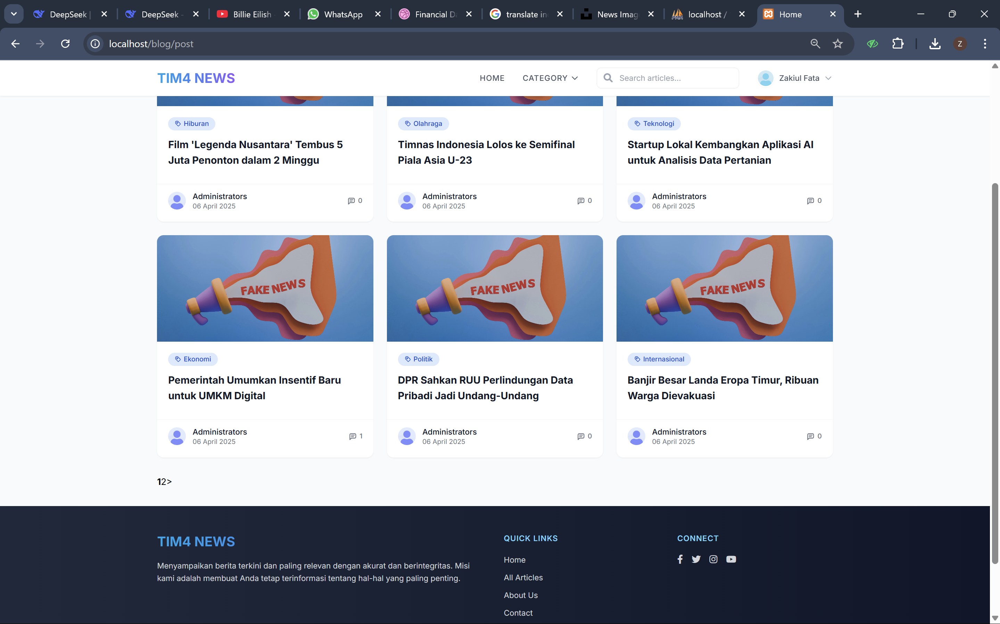

# TIM4 News – Aplikasi Manajemen Pemberitaan

Aplikasi web pemberitaan dengan halaman baca untuk pengunjung dan dashboard admin untuk mengelola konten. Dibangun dengan **CodeIgniter 3** dan **PHP**.

> Proyek UAS mata kuliah Pemrograman Web (proyek kelompok). Dikembangkan oleh **Zakiul Fata** sebagai pengembang utama.

## Tampilan

| Dashboard Admin | Halaman Berita | Detail Berita |
|---|---|---|


 |

## Fitur

**Halaman publik**
- Daftar berita terbaru dengan tampilan kartu
- Penelusuran berita berdasarkan kategori
- Pencarian artikel
- Halaman detail berita
- Komentar pada artikel
- Daftar berita terbaru dan komentar terbaru di sisi halaman

**Dashboard admin**
- Login administrator
- Ringkasan jumlah kategori, artikel, anggota, dan komentar
- Grafik perbandingan data dan aktivitas bulanan
- Pengelolaan kategori
- Pengelolaan artikel (post)
- Pengelolaan anggota
- Pengelolaan komentar

## Teknologi

- PHP
- CodeIgniter 3
- MySQL
- HTML, CSS, JavaScript
- XAMPP (lingkungan pengembangan lokal)

## Cara Menjalankan

### Prasyarat
- [XAMPP](https://www.apachefriends.org/) (Apache dan MySQL)
- Browser

### Langkah

1. **Unduh proyek** dan letakkan di folder web server:
   ```
   C:\xampp\htdocs\pemberitaan
   ```

2. **Nyalakan Apache dan MySQL** lewat XAMPP Control Panel.

3. **Buat database** di `http://localhost/phpmyadmin`, lalu **Import** file `database.sql` dari folder proyek.

4. **Atur koneksi database** di `application/config/database.php`:
   ```php
   'hostname' => 'localhost',
   'username' => 'root',
   'password' => '',
   'database' => 'nama_database_kamu',
   ```

5. **Atur base URL** di `application/config/config.php`:
   ```php
   $config['base_url'] = 'http://localhost/pemberitaan/';
   ```

6. **Buka di browser:**
   - Halaman publik: `http://localhost/pemberitaan/`
   - Dashboard admin: `http://localhost/pemberitaan/dashboard`

Akun admin tersedia di tabel pengguna pada `database.sql`.

## Struktur Folder

```
pemberitaan/
├── application/     # controller, model, view, dan konfigurasi aplikasi
├── system/          # inti framework CodeIgniter
├── docs/            # tangkapan layar untuk dokumentasi
├── database.sql     # struktur dan data awal database
└── index.php
```

## Penulis

**Zakiul Fata**
- GitHub: [@zakiulFata](https://github.com/zakiulFata)
- Email: zakiulfata292@gmail.com