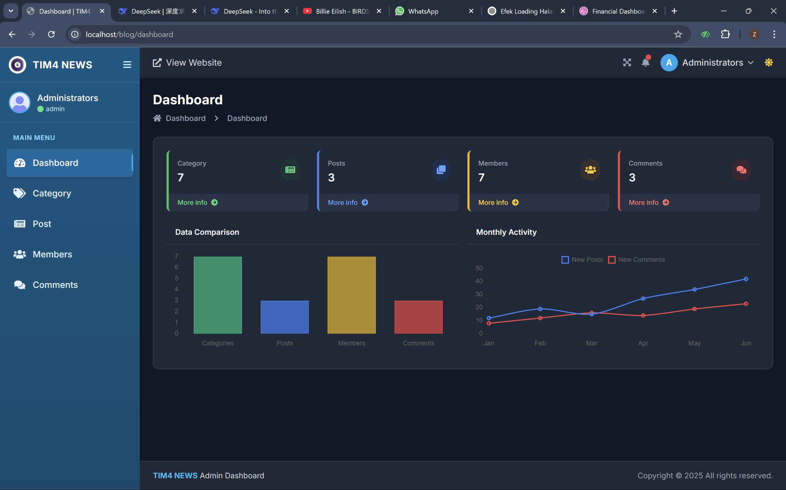

# TIM4 News – Aplikasi Manajemen Pemberitaan

Aplikasi web pemberitaan dengan **halaman baca untuk pengunjung** dan **dashboard admin** untuk mengelola kategori, artikel, anggota, dan komentar. Dibangun menggunakan **CodeIgniter 3** dan **PHP**.

> Proyek UAS mata kuliah Pemrograman Web (proyek kelompok).
> Dikembangkan oleh **Zakiul Fata** sebagai pengembang utama.

---

## Daftar Isi

- [Tampilan](#tampilan)
- [Fitur](#fitur)
- [Teknologi](#teknologi)
- [Prasyarat](#prasyarat)
- [Cara Menjalankan](#cara-menjalankan)
- [Akun Admin](#akun-admin)
- [Struktur Folder](#struktur-folder)
- [Masalah Umum](#masalah-umum)
- [Penulis](#penulis)

---

## Tampilan

### Dashboard Admin


### Halaman Berita


### Detail Berita


---

## Fitur

### Halaman Publik
- Daftar berita terbaru dalam tampilan kartu
- Penelusuran berita berdasarkan kategori
- Pencarian artikel
- Halaman detail berita
- Komentar pada artikel
- Daftar berita terbaru dan komentar terbaru di sisi halaman
- Penomoran halaman (pagination) pada daftar berita

### Dashboard Admin
- Login administrator
- Ringkasan jumlah kategori, artikel, anggota, dan komentar
- Grafik perbandingan data dan aktivitas bulanan
- Pengelolaan kategori
- Pengelolaan artikel (post)
- Pengelolaan anggota
- Pengelolaan komentar
- Tautan cepat untuk melihat tampilan website

---

## Teknologi

| Bagian | Teknologi |
|---|---|
| Bahasa | PHP, JavaScript |
| Framework | CodeIgniter 3 |
| Database | MySQL |
| Tampilan | HTML, CSS |
| Lingkungan lokal | XAMPP (Apache dan MySQL) |

---

## Prasyarat

- [XAMPP](https://www.apachefriends.org/) (Apache dan MySQL)
- Browser modern (Chrome, Edge, atau Firefox)
- Git (opsional, jika ingin meng-clone repositori)

---

## Cara Menjalankan

### 1. Ambil proyek

Clone repositori ke folder web server:

```bash
cd C:\xampp\htdocs
git clone https://github.com/zakiulFata/aplikasi_manajemen_pemberitaan.git pemberitaan
```

Atau unduh sebagai ZIP, ekstrak, lalu ubah nama foldernya menjadi `pemberitaan` di dalam `C:\xampp\htdocs`.

### 2. Nyalakan server

Buka **XAMPP Control Panel**, lalu klik **Start** pada **Apache** dan **MySQL**. Keduanya harus berwarna hijau.

### 3. Siapkan database

1. Buka `http://localhost/phpmyadmin`.
2. Buat database baru, misalnya `db_pemberitaan` (collation `utf8mb4_general_ci`).
3. Pilih database itu, buka tab **Import**, pilih file `database.sql` dari folder proyek, lalu klik **Import**.

### 4. Atur koneksi database

Buka `application/config/database.php`, lalu sesuaikan:

```php
'hostname' => 'localhost',
'username' => 'root',
'password' => '',
'database' => 'db_pemberitaan',
```

### 5. Atur base URL

Buka `application/config/config.php`, lalu sesuaikan:

```php
$config['base_url'] = 'http://localhost/pemberitaan/';
```

### 6. Buka di browser

| Halaman | Alamat |
|---|---|
| Halaman publik | `http://localhost/pemberitaan/` |
| Dashboard admin | `http://localhost/pemberitaan/dashboard` |

---

## Akun Admin

Akun administrator awal tersedia di tabel pengguna pada file `database.sql`. Setelah berhasil masuk, sebaiknya ubah kata sandi akun tersebut.

> Kata sandi tidak dicantumkan di repositori ini. Jangan memakai kata sandi yang sama dengan akun pribadi pada data uji.

---

## Struktur Folder

```
pemberitaan/
├── application/        # controller, model, view, dan konfigurasi aplikasi
│   ├── config/
│   ├── controllers/
│   ├── models/
│   └── views/
├── assets/             # file CSS, JavaScript, dan gambar
├── docs/
│   └── screenshots/    # tangkapan layar untuk dokumentasi
├── system/             # inti framework CodeIgniter
├── database.sql        # struktur dan data awal database
└── index.php
```

---

## Masalah Umum

| Gejala | Penyebab dan solusi |
|---|---|
| Apache tidak mau Start | Port 80 dipakai aplikasi lain. Tutup aplikasi itu atau ubah port di XAMPP. |
| MySQL tidak mau Start | Port 3306 bentrok. Hentikan layanan MySQL lain atau ubah port di `my.ini`. |
| *Unable to connect to your database* | Nama database, username, atau password di `database.php` tidak sesuai. |
| Halaman 404 pada semua menu | `base_url` salah atau `mod_rewrite` Apache belum aktif. Pastikan `.htaccess` ada. |
| Halaman putih kosong | Ada error PHP. Ubah `ENVIRONMENT` di `index.php` menjadi `development` untuk melihat pesan error. |
| Gambar tidak muncul | Cek folder `assets` atau folder unggahan, dan pastikan jalurnya benar. |

---

## Catatan

Proyek ini dibuat untuk keperluan pembelajaran (UAS Pemrograman Web) dan dibangun di atas [CodeIgniter 3](https://codeigniter.com/), yang dirilis dengan lisensi MIT.

---

## Penulis

**Zakiul Fata**

- GitHub: [@zakiulFata](https://github.com/zakiulFata)
- Email: zakiulfata292@gmail.com